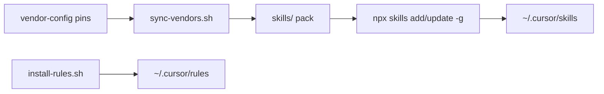

# Architecture

## Stack

- Skills CLI (`npx skills`) for consumer add/update (Cursor, global `-g`)
- Published pack: committed folders under `skills/` (SKILL.md layout)
- Publisher: Bash (`ai/sync-vendors.sh`, `ai/install-rules.sh`, `ai/scripts/check-vendor-drift.sh`)
- Vendor pins: Matt Pocock skills, obra/superpowers, NVIDIA SkillSpector (`ai/vendor-config.sh`)
- CI: GitHub Actions `vendor-drift` (weekly; alert only)

No application runtime. Catalog + install tooling only.

## Structure

```text
skills/                         # Published pack (npx skills discovers here)
ai/
  skills/{engineering,productivity,misc,deprecated}/  # house sources (+ deprecated)
  rules/                        # Cursor .mdc (install-rules.sh)
  sync-vendors.sh               # publisher → skills/
  install-rules.sh              # consumer rules step
  vendor-config.sh
  overlays/domain-modeling/
  scripts/check-vendor-drift.sh
context/adr/
docs/
.github/workflows/vendor-drift.yml
```

## Flow



## Also read

- [Glossary](../CONTEXT.md)
- [Changelog](../CHANGELOG.md)
- [Catalog reference](ai-catalog.md)
- [ADR 0021 — Skills CLI published pack](../context/adr/0021-skills-cli-published-pack.md)
